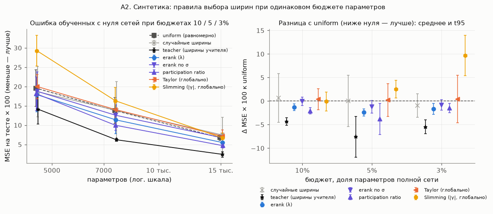
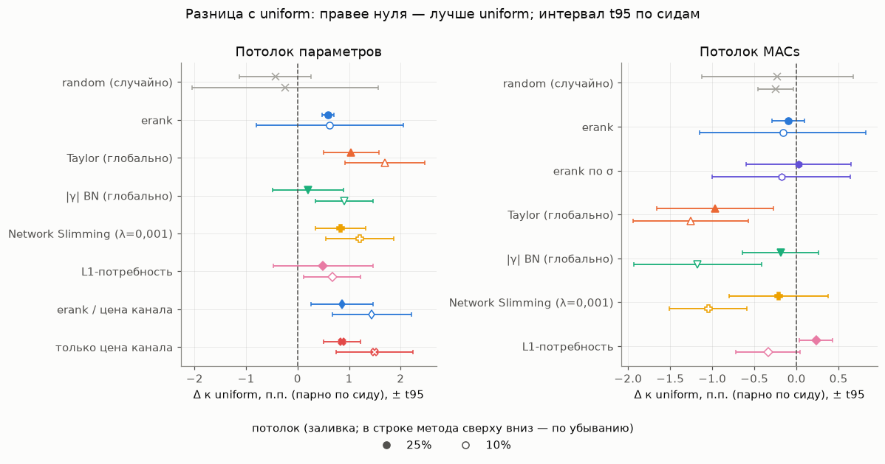
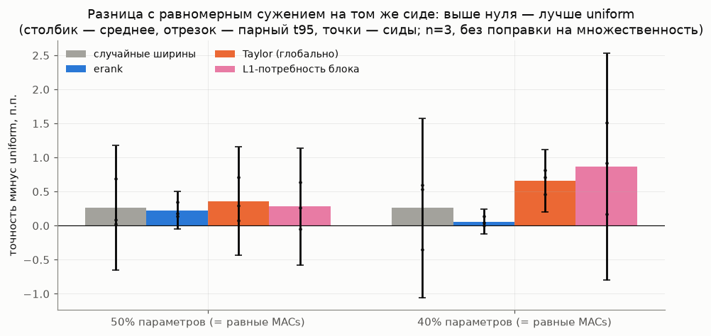
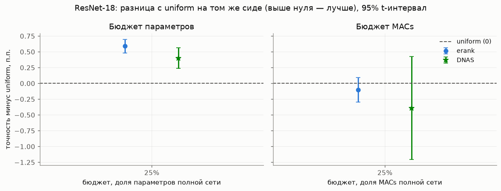
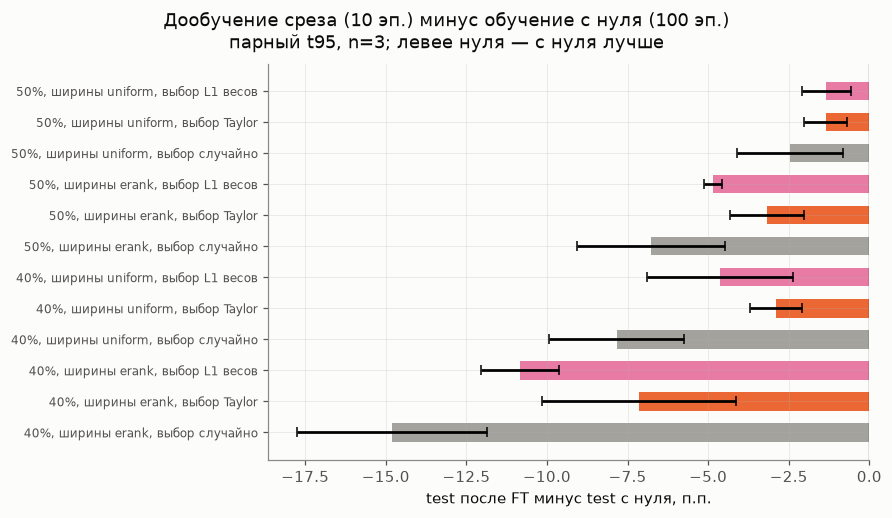

# Ширины слоёв по эффективному рангу

Годится ли эффективный ранг (erank) активаций слоя как правило выбора ширин слоёв? Сравниваем его с равномерным
сужением (uniform), случайными ширинами, критериями прунинга (Taylor, Network Slimming, L1) и DNAS. Весь код —
внутри ноутбуков, выводы и графики полного прогона сохранены в них же.

| Ноутбук | Модель и данные | Сиды |
|---|---|---|
| [01_mlp](01_mlp.ipynb) | MLP: синтетика (учитель 64-8-32) и MNIST | 5 |
| [02_resnet18](02_resnet18.ipynb) | ResNet-18, CIFAR-10 | 3 |
| [03_vit](03_vit.ipynb) | ViT-Tiny, CIFAR-10 | 3 |
| [04_dnas](04_dnas.ipynb) | DNAS: синтетика (MLP) и ResNet-18, CIFAR-10 | 5 / 3 |
| [erank_full/01_resnet18](erank_full/01_resnet18_erank_full.ipynb) | ResNet-18, CIFAR-10: нормировки erank, ширины с нуля | 3 |
| [erank_full/02_vit](erank_full/02_vit_erank_full.ipynb) | ViT-Tiny, CIFAR-10: то же | 3 |

## Что получилось

erank — экспонента энтропии нормированных собственных чисел ковариации активаций слоя. Числа — разница точности с
uniform в п.п., в скобках парный 95% интервал по сидам. Интервал, содержащий ноль, — «не отличима от нуля», а не
«методы равны».

**MLP.** На синтетике, где правильные ширины известны (ширины учителя), erank лучше uniform при всех 3 бюджетах; на
MNIST не отличим от uniform ни при одном из 6 бюджетов.



**ResNet-18.** При 25% параметров erank +0,59 [+0,48; +0,70], но тратит в 1,6 раза больше MACs; при равных MACs
не отличим от uniform. Taylor по среднему выше: +1,04 и +1,70 при 25% и 10% параметров.



**ViT-Tiny.** erank не отличим от uniform (+0,22 и +0,06 при 50% и 40% параметров); Taylor при 40% выше erank на
+0,60 [+0,10; +1,11].



**DNAS.** На ResNet-18 при 25% параметров выше uniform (+0,40), но ниже erank (−0,19); при 25% MACs не отличим от
uniform. Поиск — 2,9 мин GPU на бюджет, замер erank — 7,7 с.



**Срез + дообучение против обучения с нуля.** У ResNet-18 дообучение хуже в 35 из 42 пар, у ViT — во всех 36
(график), у MLP — в обе стороны.



## Нормировки erank и правила ширин с нуля

Ноутбуки в `erank_full/`: шесть нормировок erank (raw, центрированная, L2→центр, центр→L2, корреляционная, по σ)
против uniform, random, L1, L2, Taylor, Taylor/цена и Network Slimming. Каждая сеть обучается с нуля (ResNet-18 —
30 эпох, ViT-Tiny — 100), 3 сида; отдельно — дообучение среза учителя против обучения с нуля.

- **Нормировка erank** почти не меняет ширины и точность: ResNet-18 91,34–91,76%, ViT-Tiny 81,52–81,87%.
- **ResNet-18, 25% параметров:** L2 92,04% и Taylor/цена 91,99% выше erank (91,42%) и uniform (91,22%), но тратят в
  1,8–1,9 раза больше MACs, чем erank. **При 25% MACs** лучший erank: 91,28% против 91,01% у uniform (не отличим) и
  90,2–90,6% у L2, Taylor и Slimming.
- **ViT-Tiny, 50% параметров** (режутся только MLP): все правила 81,3–82,3%, ни одно не лучше uniform сверх разброса
  между запусками; erank даёт меньше всего каналов первому блоку, самому чувствительному к срезу.
- **Дообучение среза** (10 эпох): у ResNet-18 лучше обучения с нуля в 15 из 24 пар (−0,3…+0,6 п.п.), у ViT-Tiny хуже
  во всех 18 парах без low-rank (−0,8…−3,8 п.п.).

## Запуск

```powershell
python -m venv .venv
.\.venv\Scripts\Activate.ps1          # Linux / macOS: source .venv/bin/activate
python -m pip install torch==2.12.1 torchvision==0.27.1 --index-url https://download.pytorch.org/whl/cu130
python -m pip install -r requirements.txt
python -m jupyterlab
```

- **Данные** — в `data/` рядом с ноутбуками или в `../data/`: `MNIST/raw/` (01), `cifar-10-batches-py/` (02–04),
  `cifar-100-python/` (только вариант CIFAR-100 в 02). Сами ноутбуки ничего не скачивают; чтобы скачал torchvision,
  поставить `DOWNLOAD = True` в первой ячейке кода.
- **Быстрая проверка** — `QUICK = True` в первой строке первой ячейки кода: все ячейки за несколько минут, числа
  смысла не имеют.
- **Кэш** — результаты и веса пишутся в `runs/`, повторный запуск продолжает с места остановки. Пересчитать заново:
  удалить `runs/<ноутбук>.jsonl` и `runs/ckpt/<ноутбук>/`.
- **`erank_full/`** — CIFAR-10 ищется в `data/` и `../data/`, если его нет — скачивается в `data/`; кэш пишется в
  `erank_runs/`, повторный запуск продолжает с места остановки; `ERANK_SMOKE=1` в окружении — быстрая проверка.
- Полные прогоны рассчитаны на GPU. Проверено на Python 3.13, torch 2.12.1+cu130; ResNet и ViT обучаются в
  bfloat16, поэтому побитового совпадения на другой GPU не будет.
